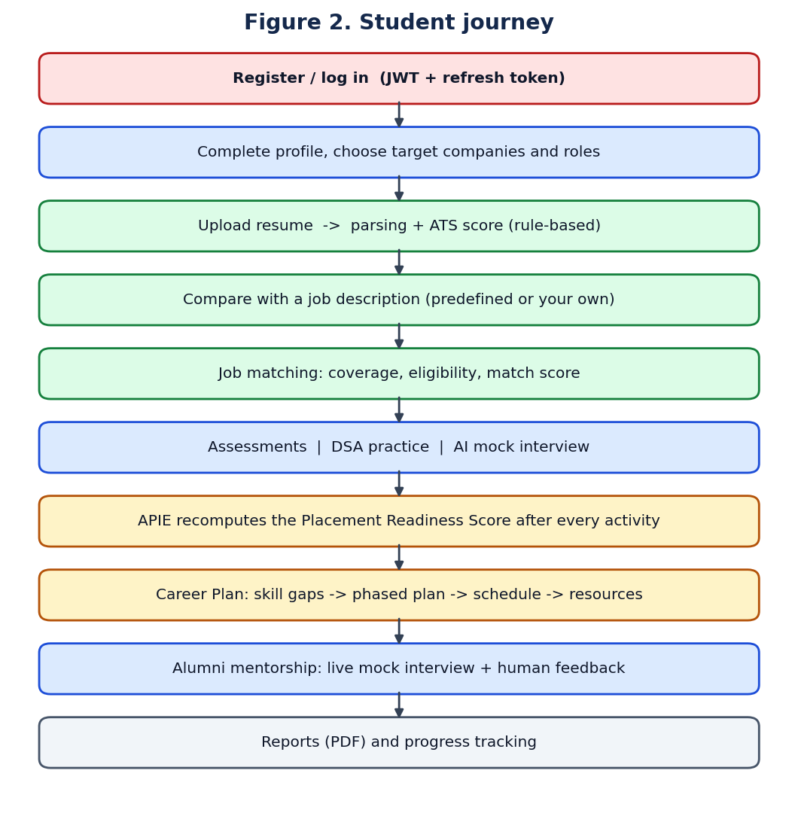

# Executive summary

## What CareerPilot AI is

CareerPilot AI is a web platform that prepares engineering students for campus placement. One student account covers resume analysis, job matching, aptitude and technical assessments, DSA coding practice, AI mock interviews, a placement readiness score, a personalised career plan and mentorship from verified alumni. Placement officers and administrators see the same data as cohort analytics.

**One-sentence technical summary:** it is a three-service system (React, Node.js, Python) in which *deterministic algorithms compute every score* and *language models are used only for language* — asking interview questions, judging free-text answers and phrasing advice — with every model output validated and every final score recomputed in code.

## How to read the status labels

Every feature in this document carries one of these labels. Use the same words in front of the jury.

| Label | Meaning |
|---|---|
| [IMPLEMENTED] | Code exists, runs, and is covered by tests or was exercised end to end |
| [PARTIALLY IMPLEMENTED] | Built, but a stated part is missing, switched off, or unverified |
| [PLANNED] | Designed or reserved in the code, not built |
| [NOT VERIFIED FROM SOURCE] | Could not be confirmed from the repository |
| [NOT YET MEASURED] | The measurement has not been run; no number may be quoted |

## Status of the headline features

| Feature | Status | The one fact to remember |
|---|---|---|
| Authentication, roles, audit | [IMPLEMENTED] | JWT with refresh-token rotation; four active roles |
| Resume parsing and rule-based ATS score | [IMPLEMENTED] | Nine capped criteria summing to 100; no model needed |
| Compare resume with a job description | [IMPLEMENTED] | Predefined JD or the student's own (pasted or uploaded) |
| Job matching | [IMPLEMENTED] | Weighted formula; eligibility is a hard gate |
| Assessment engine | [IMPLEMENTED] | Server-authoritative timer, autosave, server-side grading |
| AI mock interview (text and voice) | [IMPLEMENTED] | Difficulty adapts; overall score recomputed in code |
| APIE Placement Readiness Score | [IMPLEMENTED] | Seven weighted components; weights are not validated |
| Random Forest readiness classifier | [IMPLEMENTED] | Trained on synthetic data; accuracy 0.735 |
| RAG knowledge base | [IMPLEMENTED] | Refuses to answer below a relevance threshold |
| Career Plan (rule-based planner) | [IMPLEMENTED] | Deterministic; 20 roles, 122 skills, 270 resources |
| DSA judge: code generation, protocol, verdicts | [IMPLEMENTED] | 28 problems, four languages, 112 reference programs accepted |
| DSA judge: Docker container isolation | [PARTIALLY IMPLEMENTED] | Code complete; not yet run on a machine with Docker |
| Fine-tuned ATS model (Qwen3-4B, QLoRA) | [PARTIALLY IMPLEMENTED] | Pipeline and integration built; **training not run** |
| Fine-tuned career model (Qwen3-1.7B, QLoRA) | [PARTIALLY IMPLEMENTED] | v1 trained; **0% fully valid plans; switched off** |
| Alumni mentorship and WebRTC interview room | [IMPLEMENTED] | Human feedback feeds the readiness score |
| Institutional analytics and PDF reports | [IMPLEMENTED] | Ten report types |
| Recruiter role | [PLANNED] | The role constant exists; no recruiter screens |
| Admin screen to create DSA problems | [PLANNED] | Problems are loaded from a seed file |
| Job queue for the judge | [PLANNED] | An in-process concurrency limiter is used instead |

> **The honest headline.** The platform works end to end on deterministic engines. Neither fine-tuned language model is serving users: the ATS model has not been trained, and the first career model was trained and measured as not usable. Say this plainly; the design that makes the product work without them is one of its strengths.

# Problem statement and proposed system

## The problem

A student preparing for placement uses separate tools that do not share information: a resume checker, a coding site, an aptitude site, interview videos and a learning platform. Three problems follow.

- **No single picture.** Nothing tells the student how ready they are overall, or what to fix first.
- **Unexplained scores.** Many resume checkers return a number without saying how it was computed.
- **No institutional view.** A placement officer cannot see which students are at risk until results arrive.

## Existing approach and its limits

| Conventional single-purpose tool | What it typically covers | What it leaves out |
|---|---|---|
| Resume checker | A resume score and keyword hints | Coding, interviews, a plan, institutional view |
| DSA practice site | Problems, judge, submissions | Resume, readiness, career guidance |
| Learning platform | Courses | Personal gap analysis against a target role |
| Job portal | Listings and applications | Preparation and measurement |

This comparison is against a *typical single-purpose* tool. Large commercial platforms offer several of these features together; the claim is about integration and explainability for a campus setting, not about any feature being unique.

## Proposed system

CareerPilot AI puts the preparation steps on one account and connects them through one scoring engine, APIE. Every scored activity (resume, assessment, coding submission, interview answer, alumni feedback) triggers a readiness recomputation, so the dashboard always reflects the latest evidence.

## Objectives

1. Give each student one explainable readiness score with its components, weights and reasons.
2. Analyse resumes with a transparent rule-based ATS score and job-description comparison.
3. Provide practice for each placement stage: aptitude, coding, technical and HR interviews.
4. Produce a personal career plan from the gap between a student's skills and a target role.
5. Connect students with verified alumni and feed human feedback back into the score.
6. Give placement staff cohort analytics and at-risk identification.
7. Keep AI use safe: validated outputs, deterministic scores, honest labels for prototype models.

## Users and roles

| Role | Exists in code | What they do |
|---|---|---|
| Student | [IMPLEMENTED] | All preparation features |
| Alumni | [IMPLEMENTED] | Profile, mentorship requests, sessions, structured feedback |
| Placement Officer | [IMPLEMENTED] | Cohort dashboard, analytics, student list, reports |
| Administrator | [IMPLEMENTED] | Users, companies, jobs, alumni verification, AI usage, audit log, APIE weights |
| Recruiter | [PLANNED] | The role constant is reserved; no screens or routes |
| Faculty / Trainer | Not in the repository | Do not mention this role |

## Functional requirements (as built)

| Area | Requirement | Status |
|---|---|---|
| Accounts | Register, log in, refresh, log out, role-based access | [IMPLEMENTED] |
| Resume | Upload PDF/DOCX/TXT, parse, score, compare with a JD, re-analyse, download | [IMPLEMENTED] |
| Jobs | Company and job catalogue, match a profile to a job | [IMPLEMENTED] |
| Assessments | Timed papers, autosave, recovery, grading, integrity signals | [IMPLEMENTED] |
| DSA | Problem list with filters, editor, Run, Submit, history, progress | [IMPLEMENTED] |
| Interview | Technical, HR and behavioural modes, text or voice | [IMPLEMENTED] |
| Readiness | Score, bands, skill gaps, recommendations, trend | [IMPLEMENTED] |
| Career plan | Role catalogue, skill gap, phased plan, schedule, resources, progress | [IMPLEMENTED] |
| Mentorship | Alumni directory, requests, scheduling, WebRTC room, feedback | [IMPLEMENTED] |
| Analytics | Cohort readiness, skill gaps, at-risk list, research export | [IMPLEMENTED] |
| Reports | PDF generation for ten report types | [IMPLEMENTED] |
| Privacy | Data export and deletion endpoints | [IMPLEMENTED] |

## Non-functional requirements

| Quality | How it is addressed | Status |
|---|---|---|
| Security | JWT, RBAC, validation, rate limits, sandboxed code | [IMPLEMENTED]; sandbox [PARTIALLY IMPLEMENTED] |
| Explainability | Every score returns its components and reasons | [IMPLEMENTED] |
| Availability of scores | Scores are deterministic and work with the LLM down | [IMPLEMENTED] |
| Testability | Automated suites in all three services | [IMPLEMENTED] |
| Performance | Indexes, pagination, lazy loading, concurrency cap | [IMPLEMENTED]; no benchmark [NOT YET MEASURED] |
| Portability | Docker Compose for the three services and MongoDB | [IMPLEMENTED] |
| Honesty of data | Records labelled DEMO, SYNTHETIC or REAL | [IMPLEMENTED] |
