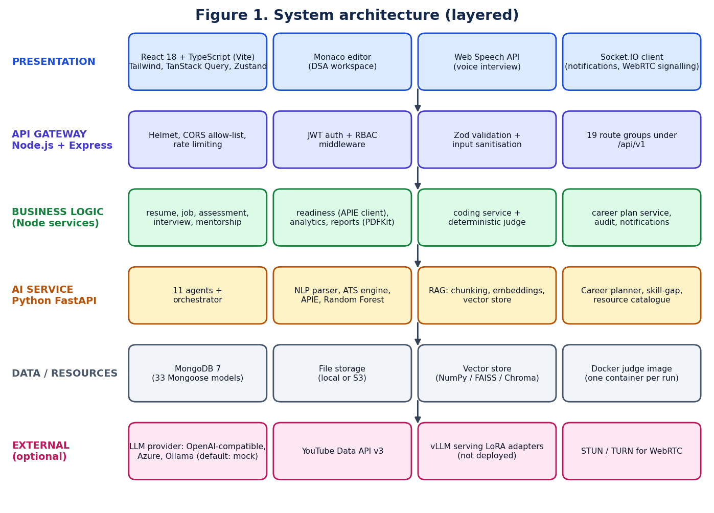
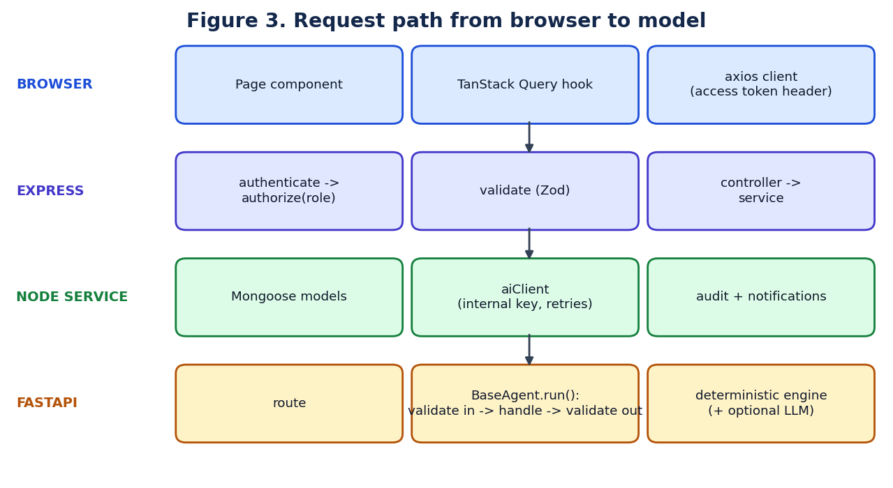
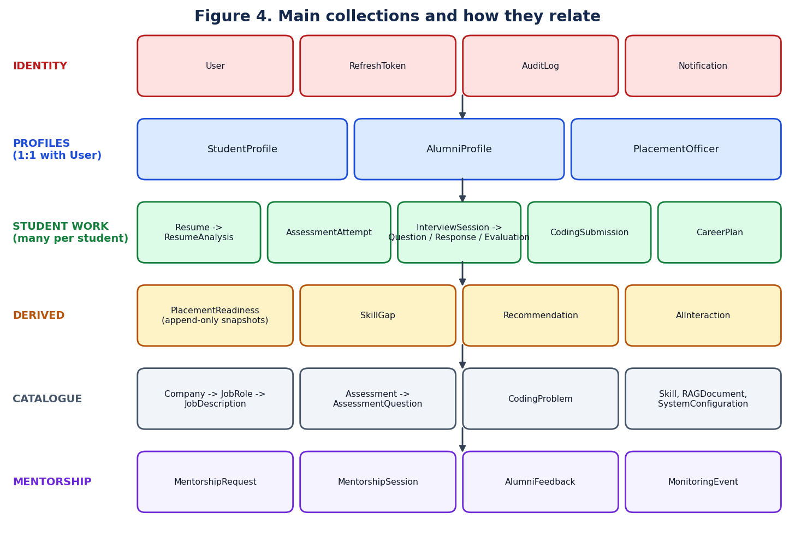
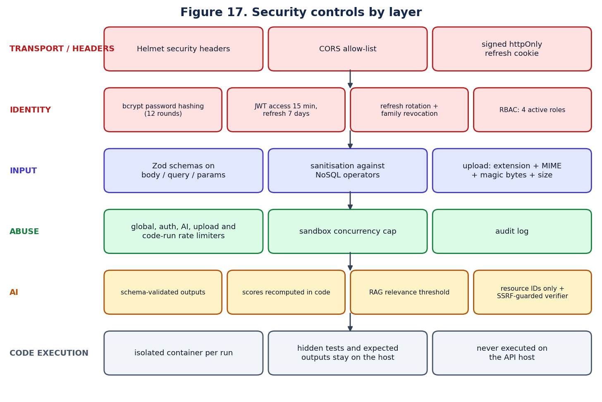
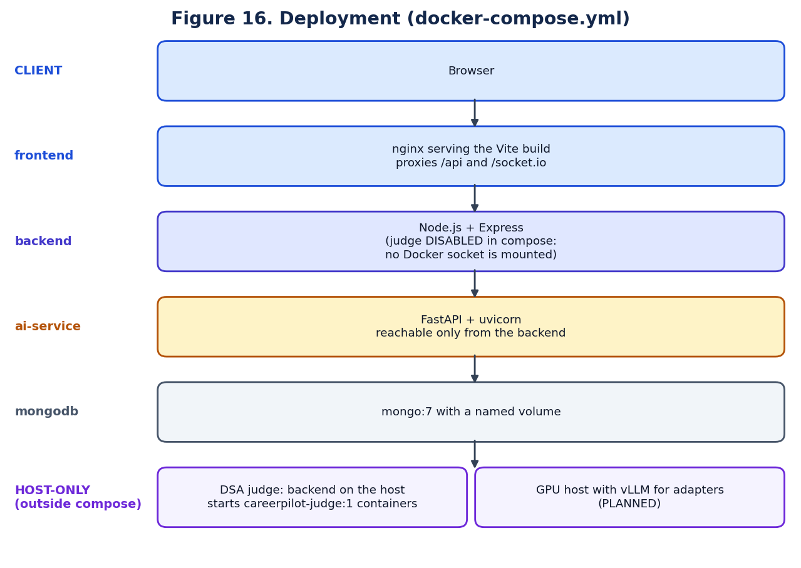

# System architecture

## High-level architecture

Three services with one trust boundary. The browser talks only to the Node.js gateway. The gateway is the only caller of the Python AI service, and it authenticates with a shared internal key. Model access and API keys never reach the browser.

```
React (Vite, TypeScript)  --HTTP / WebSocket-->  Node.js + Express gateway  --HTTP + internal key-->  Python FastAPI AI service
   UI, Monaco, voice                              auth, RBAC, MongoDB,                                  agents, NLP, ATS, APIE,
                                                  Socket.IO, PDF, judge                                 RAG, ML, career planner
```



## Why three services instead of one

| Decision | Reason | Alternative considered | Why not |
|---|---|---|---|
| Node.js for the gateway | I/O-heavy work: auth, sockets, database, file streaming | A single Python service | Weaker real-time and WebSocket ergonomics; one service would mix web and ML concerns |
| Python for AI | The NLP/ML libraries (spaCy, scikit-learn, NumPy, PyMuPDF) live there | Running ML in Node | No mature equivalents for spaCy or scikit-learn |
| Shared TypeScript package | Frontend and backend import the same types and enums | Duplicated types | Types drift apart silently |
| Gateway is the only AI caller | One place to enforce auth, rate limits and audit | Browser calls the AI service | Would expose the internal key and bypass access control |

This is a small **service-oriented** design with three services, not a microservices deployment: there is no service discovery, message bus or per-service database.

## Detailed request path



1. A page component calls a TanStack Query hook, which calls the axios client with the access token.
2. Express runs global middleware: Helmet, CORS, compression, body parsing (2 MB limit), request id, timing, input sanitisation, then the global rate limiter.
3. The route applies `authenticate`, `authorize(role)`, `validate(zodSchema)` and then the controller.
4. The controller calls a service. Services own business rules and Mongoose access.
5. If AI work is needed, `aiClient` posts to FastAPI with the internal key, retries on connection errors and translates failures into typed API errors.
6. In FastAPI, `BaseAgent.run()` validates the input model, runs `handle()`, validates the output model and records latency and provider.

## Layer responsibilities

| Layer | Folder | Responsibility |
|---|---|---|
| Presentation | `frontend/src/pages`, `components`, `layouts` | 38 page components, shared UI kit, route-level code splitting |
| Client state | `frontend/src/store`, TanStack Query | Auth store (Zustand), server-state cache |
| Routes | `backend/src/routes/v1` | 15 route files, 135 endpoints, middleware chains |
| Controllers | `backend/src/controllers` | HTTP in and out; no business rules |
| Services | `backend/src/services` | Business logic, judge, AI client, storage, reports |
| Models | `backend/src/models` | 33 Mongoose models |
| Agents | `ai-service/app/agents` | 11 agents and the orchestrator |
| AI engines | `ai-service/app/services`, `nlp`, `rag`, `ml`, `career` | Deterministic engines and model wrappers |
| Shared | `shared/src` | Types, enums, constants used by both TypeScript apps |
| Seed data | `database/seeds` | Demo companies, questions, DSA problems and reference solutions |

## Real-time and background behaviour

- **Socket.IO** pushes notifications and `readiness:updated`, and carries WebRTC signalling for the alumni interview room. [IMPLEMENTED]
- **There is no job queue or worker process.** The DSA judge runs inside the request, bounded by an in-process semaphore (`CODE_RUNNER_MAX_CONCURRENT`, default 2; up to 25 requests wait, more are refused). A queue with separate judge workers is [PLANNED].
- **There is no external cache** such as Redis. Caching is limited to an in-memory configuration cache, a 20-second cache of the Docker availability check, and the browser-side TanStack Query cache.

# Technology stack

| Layer | Technology | Role | Why selected | Alternative |
|---|---|---|---|---|
| Frontend | React 18, TypeScript, Vite | Single-page application | Component model, type safety, fast builds | Angular, Next.js |
| Frontend | Tailwind CSS, Radix UI primitives | Styling and accessible components | Consistent design with little custom CSS | Material UI |
| Frontend | TanStack Query, Zustand | Server-state cache; auth state | Caching and refetching without boilerplate | Redux |
| Frontend | Monaco editor | DSA code editor | The editor that powers VS Code | CodeMirror |
| Frontend | Recharts, react-hook-form, Zod | Charts, forms, validation | Small and typed | Chart.js, Formik |
| Backend | Node.js, Express 4 | REST API gateway | Mature middleware ecosystem | NestJS, Fastify |
| Backend | Mongoose 8 | Object modelling for MongoDB | Schemas, validation, indexes | Native driver, Prisma |
| Backend | Zod | Request validation | One schema gives types and runtime checks | Joi |
| Backend | jsonwebtoken, bcryptjs | Tokens and password hashing | Standard, well reviewed | Sessions, argon2 |
| Backend | Socket.IO | Real-time events, WebRTC signalling | Reconnection and fallbacks built in | Raw WebSocket |
| Backend | PDFKit, multer, pino | PDF reports, uploads, structured logs | Simple and dependency-light | Puppeteer, winston |
| Database | MongoDB 7 | Document store | Nested, evolving documents (resume analyses, plans, snapshots) | PostgreSQL |
| AI service | FastAPI, Pydantic 2, uvicorn | Typed HTTP API for AI | Validation is built into the framework | Flask |
| AI service | spaCy, PyMuPDF, python-docx | NER, PDF and DOCX text extraction | Reliable, offline | pdfminer, NLTK |
| AI service | scikit-learn, NumPy, pandas | Random Forest, vector maths | Standard for tabular ML | XGBoost |
| Fine-tuning | Qwen3 models, Unsloth, PEFT, bitsandbytes, TRL | QLoRA training in Colab | Fits a free T4 GPU; Apache-2.0 base models | Full fine-tuning |
| Judge | Docker, Debian image with g++, OpenJDK, Node.js, Python 3 | Isolated code execution | Standard isolation primitive | Judge0, Firecracker |
| External | YouTube Data API v3 | Video resources for the career plan | Official, returns availability | Scraping |
| External | OpenAI-compatible, Azure, Ollama, or mock | LLM provider behind one interface | Swappable; mock runs offline | A single hard-coded vendor |
| DevOps | Docker Compose, nginx, npm workspaces | Local and container deployment | One command to start the stack | Kubernetes |
| Testing | Vitest, supertest, mongodb-memory-server, pytest, Testing Library | Unit, API and component tests | Fast, isolated from real services | Jest |

> **Check before the demo.** The repository's local settings use `AI_PROVIDER=mock`, `EMBEDDING_PROVIDER=hash` and `VECTOR_DB_PROVIDER=numpy`. With the mock provider, interview questions and written feedback come from an offline rule-based generator, **not a language model**. Scores are unaffected because they are computed in code. If a judge asks "which LLM is answering right now?", the truthful answer depends on that setting.

# API architecture

All endpoints are under `/api/v1`. There are **135 endpoints in 15 route files**. Responses share one envelope: `{ success, data, meta? }` or `{ success: false, error: { code, message, details? } }`.

## Principal endpoints

| Method | Endpoint | Purpose | Auth | Database | AI involvement |
|---|---|---|---|---|---|
| POST | `/auth/register`, `/auth/login` | Create account, sign in | Public | User, RefreshToken | None |
| POST | `/auth/refresh` | Rotate the refresh token | Refresh cookie | RefreshToken | None |
| GET | `/students/me/dashboard` | Student dashboard data | Student | Several | None |
| POST | `/resumes/upload` | Upload a resume | Student | Resume + file store | None |
| POST | `/resumes/:id/analyze` | Parse and score; optional JD comparison | Student | ResumeAnalysis | Resume agent (deterministic) |
| POST | `/resumes/jd/extract` | Read text from a JD file | Student | None (not stored) | Text extraction |
| POST | `/jobs/match` | Match profile to a job | Student | JobDescription | Job-matching agent |
| POST | `/assessments/:id/start` | Start a timed attempt | Student | AssessmentAttempt | None |
| POST | `/assessments/attempts/:id/submit` | Grade an attempt | Student | AssessmentAttempt | None |
| GET | `/coding/problems` | Problem list with filters | Student | CodingProblem | None |
| POST | `/coding/problems/:id/run` | Judge on public tests | Student | None stored | None |
| POST | `/coding/problems/:id/submit` | Judge on public + hidden tests | Student | CodingSubmission | Static review after the verdict |
| GET | `/coding/progress` | Solved counts by difficulty | Student | CodingSubmission | None |
| POST | `/interviews/start` | Start an interview | Student | InterviewSession | Interview agent (LLM or mock) |
| POST | `/interviews/sessions/:id/answer` | Evaluate an answer, get next question | Student | InterviewResponse, Evaluation | Evaluation + interview agents |
| GET | `/readiness` | Current readiness with gaps | Student, staff | PlacementReadiness | APIE + Random Forest |
| POST | `/career/plan` | Generate a career plan | Student | CareerPlan | Planner (model optional, off) |
| POST | `/career/progress` | Mark skills complete | Student | CareerPlan | None |
| POST | `/mentorship/request` | Request a mentor | Student | MentorshipRequest | Mentor-matching agent |
| GET | `/analytics/placement` | Cohort analytics | Officer, admin | Aggregations | Analytics agent |
| GET | `/reports/:type` | PDF report | Role-dependent | Several | None |
| POST | `/admin/rag/query` | Test a knowledge-base question | Admin | RAGDocument | RAG pipeline |
| PUT | `/admin/config/:key` | Change APIE weights or bands | Admin | SystemConfiguration | None |

## Endpoint count by group

| Group | Mount path | Endpoints |
|---|---|---|
| Authentication | `/auth` | 12 |
| Students | `/students` | 6 |
| Resumes | `/resumes` | 10 |
| Companies and jobs | `/companies`, `/jobs` | 6 |
| Assessments | `/assessments` | 9 |
| Coding (DSA) | `/coding` | 8 |
| Interviews | `/interviews` | 6 |
| Speech | `/speech` | 2 |
| Readiness and recommendations | `/readiness`, `/recommendations` | 8 |
| Career plan | `/career` | 5 |
| Alumni and mentorship | `/alumni`, `/mentorship` | 19 |
| Analytics | `/analytics` | 4 |
| Reports | `/reports` | 4 |
| Notifications and privacy | `/notifications`, `/privacy` | 9 |
| Admin | `/admin` | 27 |

The AI service has its own internal API (`/ai/resume/*`, `/ai/interview/*`, `/ai/readiness/*`, `/ai/career/*`, `/ai/rag/*`, `/ai/coding/review`, `/ai/speech/*`, `/ai/agents`, `/health`). It is not reachable from the browser.

# Database architecture

**Technology:** MongoDB 7 through Mongoose 8. There are **33 models** and about 186 index declarations. MongoDB has no foreign keys; relationships are `ObjectId` references that Mongoose can populate, and integrity is enforced in the service layer.



## Collections by purpose

| Group | Models |
|---|---|
| Identity and audit | User, RefreshToken, AuditLog, Notification |
| Profiles | StudentProfile, AlumniProfile, PlacementOfficer |
| Resume | Resume, ResumeAnalysis |
| Jobs | Company, JobRole, JobDescription, Skill |
| Assessment | Assessment, AssessmentQuestion, AssessmentAttempt, MonitoringEvent |
| Coding | CodingProblem, CodingSubmission |
| Interview | InterviewSession, InterviewQuestion, InterviewResponse, InterviewEvaluation |
| Readiness | PlacementReadiness, SkillGap, Recommendation |
| Career | CareerPlan |
| Mentorship | MentorshipRequest, MentorshipSession, AlumniFeedback |
| AI and configuration | AIInteraction, RAGDocument, SystemConfiguration |

There is no separate "Admin" model: an administrator is a `User` with role `ADMIN`. There is no separate "Resource" collection: learning resources are a JSON catalogue inside the AI service.

## Relationships

| Relationship | Type | How it is stored |
|---|---|---|
| User — StudentProfile / AlumniProfile / PlacementOfficer | One-to-one | Profile holds `userId` (unique) |
| StudentProfile — Resume | One-to-many | Resume holds `studentId`; one is marked `isPrimary` |
| Resume — ResumeAnalysis | One-to-many | Each re-analysis adds a record |
| StudentProfile — PlacementReadiness | One-to-many | Append-only snapshots; the newest is current |
| StudentProfile — CodingSubmission — CodingProblem | Many-to-many through a join document | Submission holds `studentId` and `problemId` |
| Assessment — AssessmentQuestion | One-to-many | Question holds `assessmentId` |
| StudentProfile — AssessmentAttempt — Assessment | Many-to-many through a join document | Attempt holds both ids |
| InterviewSession — Question — Response — Evaluation | One-to-many chain | Each child holds its parent id |
| Company — JobRole — JobDescription | One-to-many | Child holds parent id |
| StudentProfile — target companies and roles | Many-to-many | Arrays of ids on the profile |
| MentorshipRequest — MentorshipSession — AlumniFeedback | One-to-one, then one-to-many | Child holds parent id |

## Schemas worth knowing

**User.** `email` (unique), `passwordHash`, `fullName`, `role`, `status`, `emailVerified`. The password is never stored in plain text.

**ResumeAnalysis.** `atsScore`, `parsed`, `breakdown` (the nine criteria), `matchedKeywords`, `missingKeywords`, `strengths`, `weaknesses`, recommendations, `targetJobDescriptionId`, `jobDescriptionSource` (CATALOGUE or CUSTOM), `jobMatchScore`, `engineVersion`, `provenance`.

**PlacementReadiness.** `score`, `band`, `components` (key, raw, normalised, weight, weighted, evidence count, stale flag), `modifiers`, `weightsSnapshot`, ML prediction, `trigger`, `computedAt`. Storing the weights with each snapshot keeps old scores interpretable after weights change.

**CodingProblem.** `title`, `slug` (unique), `difficulty`, `tags`, `description`, `examples`, `constraints`, `functionName`, `signature`, `compareMode`, `starterCode`, `supportedLanguages`, `testCases`, `hiddenTestCases`, `referenceSolutions`, `timeLimitMs` (default 2000), `memoryLimitMb` (default 128). `hiddenTestCases` and `referenceSolutions` are declared `select: false`, so no query returns them unless it asks for them by name.

**CodingSubmission.** `problemId`, `studentId`, `language`, `code`, `status` (the verdict), `passedCount`, `totalCount`, `runtimeMs`, `memoryKb`, `execution`, `score`, `aiReview`.

**CareerPlan.** Target role, inputs, the generated plan, resources, `resourcesBySkill`, schedule, readiness summary, progress, and which engine produced it.

## Why MongoDB

The data is document-shaped and evolves: a resume analysis, a readiness snapshot and a career plan are nested structures whose fields changed during development. A relational schema would need many join tables and migrations. The cost is weaker referential integrity, which is handled in services, and no multi-document transactions are relied on.

# Security architecture



| Concern | Control | Where | Status |
|---|---|---|---|
| Passwords | bcrypt hash with salt, 12 rounds | `User` model | [IMPLEMENTED] |
| Sessions | JWT access token (15 min) and refresh token (7 days) | auth service | [IMPLEMENTED] |
| Stolen refresh token | Rotation with family revocation: reuse of an old token revokes the whole family | auth service | [IMPLEMENTED] |
| Refresh token storage | Signed `httpOnly` cookie | auth controller | [IMPLEMENTED] |
| Authorisation | `authorize(role)` middleware; ownership checks in controllers | routes | [IMPLEMENTED] |
| Input validation | Zod schemas on body, query and params | `validators/` | [IMPLEMENTED] |
| NoSQL injection | `sanitizeInput` strips operator keys; validated types | middleware | [IMPLEMENTED] |
| XSS | React escapes output; Helmet headers; downloads sent as attachments with `nosniff` | frontend, backend | [IMPLEMENTED] |
| CSRF | Access token travels in a header, not a cookie; CORS allow-list | backend | [IMPLEMENTED] |
| Rate limiting | Global, auth, AI, upload and code-run limiters | middleware | [IMPLEMENTED] |
| File upload | Extension + MIME type + magic bytes + 5 MB limit + SHA-256 duplicate check | upload middleware, storage | [IMPLEMENTED] |
| Secrets | Environment variables; `.env` not committed; `.env.example` has no real values | config | [IMPLEMENTED] |
| Service boundary | AI service requires an internal key and is not exposed publicly | ai-service | [IMPLEMENTED] |
| Audit | Sensitive actions written to `AuditLog` | audit service | [IMPLEMENTED] |
| Error handling | Central handler returns coded errors; stack traces are not sent to clients | middleware | [IMPLEMENTED] |
| Code execution | Isolated container, never on the host | judge | [PARTIALLY IMPLEMENTED] (not run with Docker yet) |

## AI-specific security

| Risk | What the project does | What it does not do |
|---|---|---|
| Hallucinated scores | The model returns dimension scores; the overall is recomputed in code | — |
| Hallucinated facts | Strict Pydantic schemas (`extra="forbid"`); ATS grounding guard moves an unmatched "matched skill" to missing | — |
| Hallucinated links | The career model may output resource IDs only; unknown IDs are dropped | — |
| Unsupported answers | RAG returns a fixed "no verified information" answer below the relevance threshold, without calling the LLM | — |
| Prompt injection | Structural limits: the model cannot call tools, cannot set a final score, and its output must match a schema | There is **no dedicated prompt-injection classifier or filter** |
| Server-side request forgery | The resource verifier allows only HTTPS on the provider's domain, refuses private addresses, re-checks redirects | — |
| Bias from voice | Whether an answer was spoken or typed is not sent to the evaluator | — |

> **If asked "how do you stop prompt injection?"** Do not claim a filter. Say: "A resume or answer could contain instructions, so the design limits what the model can do with them. It has no tools, it cannot decide a score because the score is recomputed from fixed weights, and anything outside the schema is rejected. A dedicated injection detector is future work."

# Deployment architecture



- `docker-compose.yml` defines **mongodb** (mongo:7), **ai-service**, **backend** and **frontend** (nginx serving the built app and proxying `/api` and `/socket.io`). [IMPLEMENTED]
- In Compose the judge is set to `disabled`. A containerised backend would need the host's Docker socket to start judge containers, and mounting that socket is equivalent to root on the host. To use the judge, the backend runs directly on the host.
- For development, `npm run dev` starts all three services with hot reload.
- A GPU host running vLLM to serve the LoRA adapters is [PLANNED]; no such host exists in the repository's configuration.
- There is no CI pipeline, monitoring stack or cloud deployment in the repository. [NOT VERIFIED FROM SOURCE] for any production hosting.

## Environment variables (names only)

| Group | Variables |
|---|---|
| Core | `NODE_ENV`, `PORT`, `MONGODB_URI`, `USE_MEMORY_DB`, `CORS_ORIGINS` |
| Secrets | `JWT_SECRET`, `JWT_REFRESH_SECRET`, `COOKIE_SECRET`, `AI_SERVICE_INTERNAL_KEY` — values [REDACTED] |
| AI provider | `AI_PROVIDER`, `AI_API_KEY` [REDACTED], `AI_BASE_URL`, `AI_MODEL`, `AI_TEMPERATURE` |
| Retrieval | `VECTOR_DB_PROVIDER`, `EMBEDDING_PROVIDER`, `RAG_TOP_K`, `RAG_CHUNK_SIZE` |
| Fine-tuned models | `ATS_MODEL_PROVIDER`, `ATS_MODEL_ENDPOINT`, `CAREER_MODEL_PROVIDER`, `CAREER_MODEL_ENDPOINT` |
| Resources | `YOUTUBE_API_KEY` [REDACTED] |
| Judge | `CODE_EXECUTION_PROVIDER`, `CODE_RUNNER_IMAGE`, `CODE_RUNNER_CPUS`, `CODE_RUNNER_PIDS_LIMIT`, `CODE_RUNNER_MAX_CONCURRENT` |
| Speech and storage | `SPEECH_PROVIDER`, `STORAGE_PROVIDER`, `MAX_UPLOAD_SIZE_MB` |
