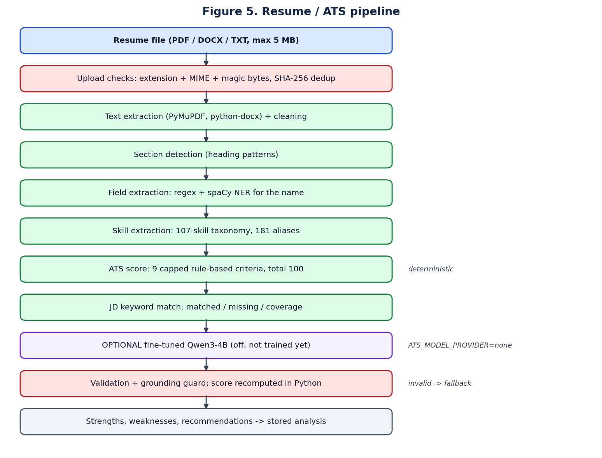
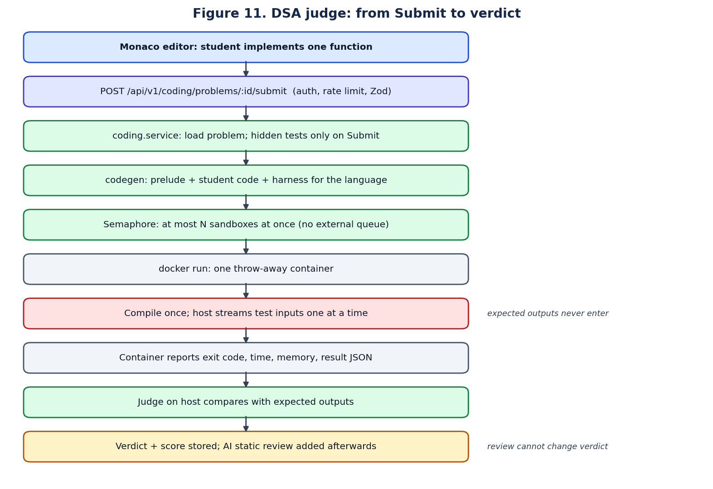
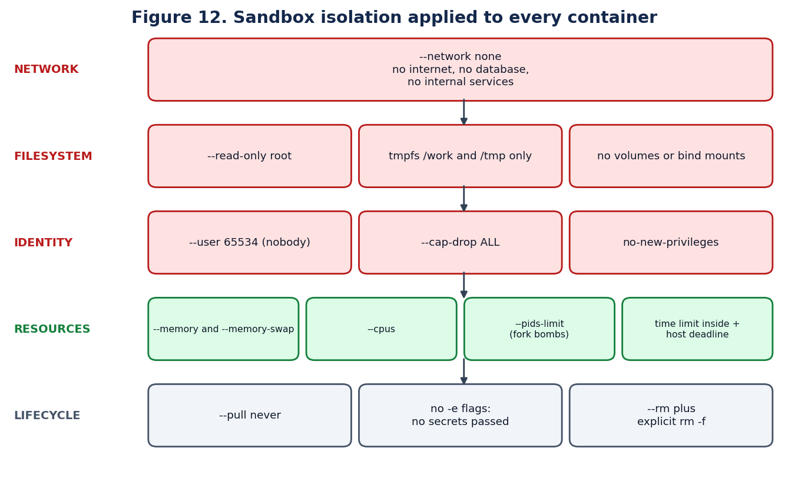
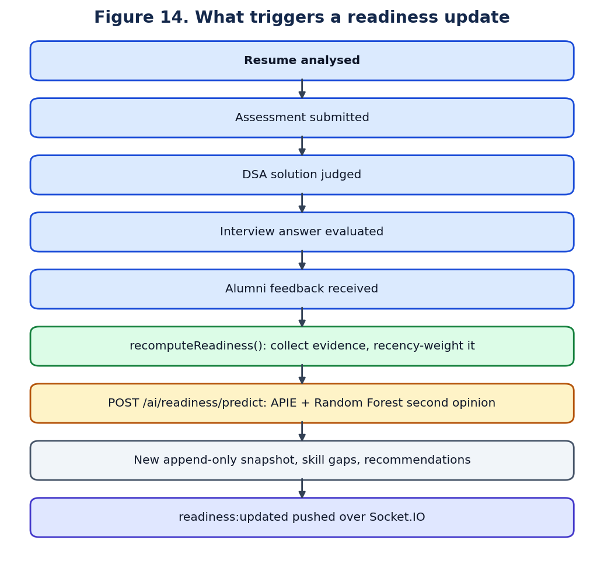
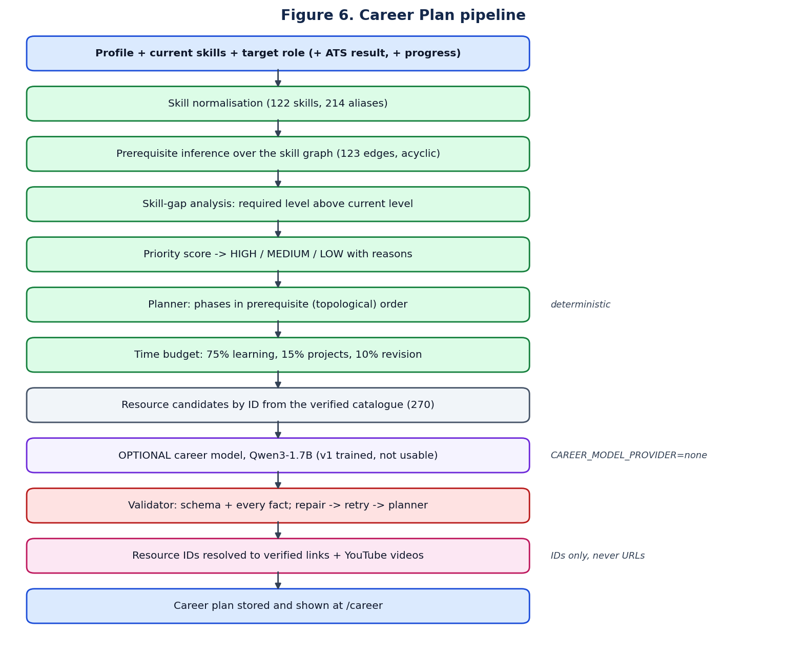
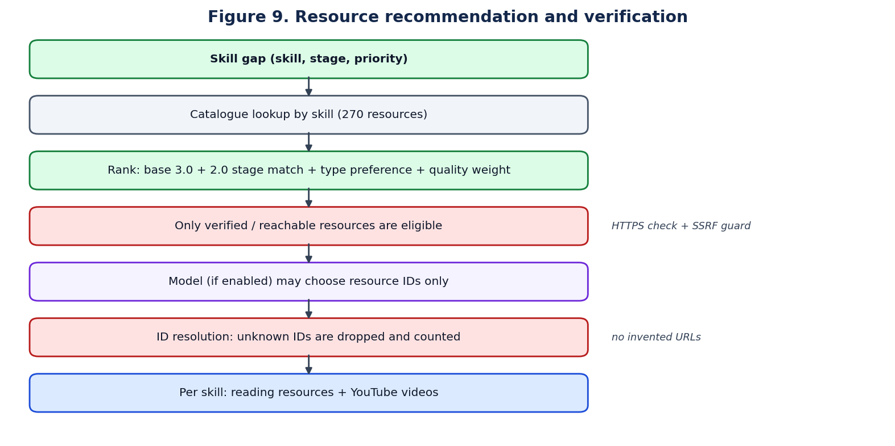
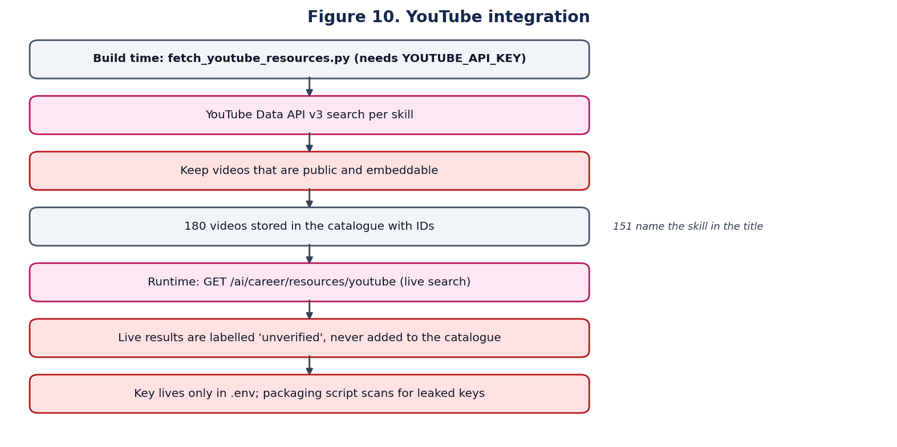
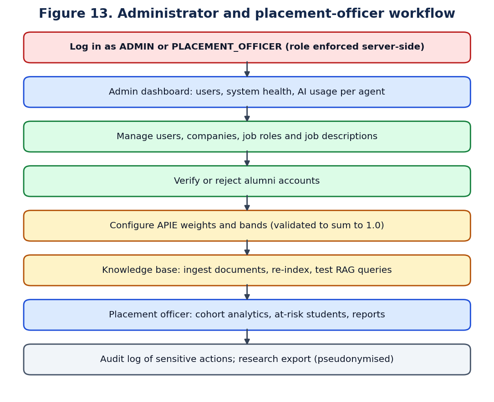

# Functional modules

Each module below follows the same template so you can answer "what goes in, what happens, what comes out" for any of them. Complexity uses *n* for the size of the input named in each block.

## Authentication and role-based access

- **Problem:** only the right person may see or change a record.
- **Input:** email and password; later an access token on each request.
- **Processing:** the password is compared with its bcrypt hash. On success the server issues a 15-minute JWT access token and a 7-day refresh token stored as a signed `httpOnly` cookie. Each refresh issues a new refresh token; presenting an old one revokes the whole token family.
- **Algorithm:** bcrypt (12 rounds); HMAC-signed JWT; refresh-token rotation with family revocation.
- **Technology:** Express middleware `authenticate`, `authorize(role)`, `requireStudentProfile`.
- **Database:** `User`, `RefreshToken`, `AuditLog`.
- **AI:** none.
- **Output:** tokens and the user's profile; 401 or 403 otherwise.
- **Time complexity:** O(1) per request plus the fixed bcrypt cost at login. **Space:** O(1).
- **Advantages:** stateless access checks; a stolen refresh token is detected on reuse.
- **Limitations:** no multi-factor authentication.
- **Status:** [IMPLEMENTED]

## Resume intelligence and ATS scoring

This is the module the jury will probe most. The full pipeline is deterministic.



- **Problem:** a student does not know why a resume scores low or what to change.
- **Input:** a PDF, DOCX or TXT file up to 5 MB; optionally a job description (predefined, pasted, or uploaded as a file).
- **Processing:**
  1. **Ingestion.** Extension, MIME type and magic bytes are checked; a SHA-256 checksum short-circuits duplicate uploads.
  2. **Text extraction.** PyMuPDF for PDF, python-docx for DOCX. Fewer than 120 characters is rejected (usually a scanned image; there is no OCR).
  3. **Section detection.** A line of at most 45 characters matching a known heading starts a section.
  4. **Field extraction.** Regular expressions for email, phone, links, CGPA, dates; spaCy NER for the name.
  5. **Skill extraction.** A taxonomy of 107 canonical skills with 181 aliases, matched with custom word boundaries so `C++` and `C#` work and "Java" is not found inside "JavaScript".
  6. **Scoring.** Nine criteria, each a capped formula.
  7. **JD comparison.** JD keywords are canonicalised; `coverage = matched / (matched + missing) × 100`.
  8. **Recommendations.** Generated from the criteria that lost points.
- **Algorithm:** rule-based NLP (regex, dictionary matching, NER) and weighted multi-criteria scoring.
- **Technology:** FastAPI, spaCy, PyMuPDF, python-docx.
- **Database:** `Resume` (file metadata), `ResumeAnalysis` (result). The file itself is in local or S3 storage.
- **AI:** deterministic by default. The optional fine-tuned model is described in the AI chapter and is off.
- **Output:** ATS score out of 100, per-criterion breakdown, extracted profile, matched and missing keywords, strengths, weaknesses, recommendations.
- **Time complexity:** O(n · t) for text length *n* and *t* taxonomy patterns (288 terms). **Space:** O(n).
- **Advantages:** explainable, repeatable, needs no GPU or training data, cannot invent a skill.
- **Limitations:** finds only skills in the taxonomy; no OCR; it approximates ATS behaviour and is not any employer's real system.
- **Status:** [IMPLEMENTED]

### The nine ATS criteria

| Criterion | Points | Rule |
|---|---|---|
| Skills coverage | 20 | min(8, skills × 0.55) + min(4, languages × 1.4) + min(4, frameworks × 1.2) + min(4, CS fundamentals × 1.4) |
| Section structure | 15 | (required sections found ÷ required) × 9 + min(6, optional sections × 1.5) |
| Experience evidence | 15 | min(7, projects × 2.2) + min(5, internships × 2.5) + min(3, jobs × 3) |
| Contact information | 10 | name 3 + email 3 + phone 2 + LinkedIn/GitHub 2 |
| Education details | 10 | education 4 + CGPA 3 + institution 1.5 + graduation year 1.5 |
| Quantified impact | 10 | min(10, quantified phrases × 1.8) |
| Formatting hygiene | 10 | starts at 10, with deductions for few bullets, very long lines, table layout, unusual symbols |
| Action verbs | 5 | min(5, distinct verbs × 0.45) − min(2, weak phrases × 0.7) |
| Length | 5 | 200–700 words scores 5; shorter or longer scores less |

Each `min(...)` is a cap. It gives diminishing returns, so listing forty skills cannot outscore a balanced resume. Projects weigh more than jobs because the users are freshers.

### Which parts are deterministic and which use AI

| Step | Deterministic | Uses a model |
|---|---|---|
| Text extraction, sections, fields | Yes | spaCy NER for the name only (a pre-trained statistical model) |
| Skill extraction | Yes (dictionary) | No |
| ATS score | Yes | No |
| Matched / missing keywords | Yes | No, even when the fine-tuned model is enabled |
| Strengths, weaknesses, advice | Yes (templates) | Optional fine-tuned model, currently off |

## Job matching

- **Problem:** which jobs suit this profile, and what is missing for a given job.
- **Input:** the student's skills, CGPA and backlogs; a job description.
- **Processing and algorithm:**

```
match = 0.55 × required-skill coverage
      + 0.20 × preferred-skill coverage
      + 0.15 × semantic similarity (profile text vs JD text)
      + 0.10 × eligibility fit (CGPA, backlogs)
```

- Coverage is computed on canonical skills. Similarity is the cosine of two embedding vectors. Failing a stated CGPA or backlog limit sets `eligible = false` whatever the score.
- **Database:** `JobDescription`, `Company`, `JobRole`, `StudentProfile`.
- **AI:** embeddings only; no generative model.
- **Output:** match score, missing skills, eligibility, a preparation plan.
- **Time complexity:** O(s + d) for *s* skills and embedding dimension *d* = 384. **Space:** O(d).
- **Limitations:** the default embedding is lexical, not semantic.
- **Status:** [IMPLEMENTED]

## Assessment engine

- **Problem:** fair, recoverable timed tests.
- **Processing:** the deadline is stored on the server and the browser timer is only a display. Answers autosave and survive a refresh. Grading happens on the server; correct answers never reach the browser. Integrity signals such as tab switches produce a LOW, MEDIUM or HIGH indicator for a human to review.
- **Algorithm:** server-authoritative timing; rule-based grading; threshold-based integrity level.
- **Database:** `Assessment`, `AssessmentQuestion`, `AssessmentAttempt`, `MonitoringEvent`.
- **AI:** none.
- **Output:** score, topic breakdown, and the integrity log shown openly to the student.
- **Time complexity:** O(q) for *q* questions.
- **Limitations:** a signal never fails a student automatically, by design.
- **Status:** [IMPLEMENTED]

## DSA practice and the online judge



- **Problem:** practise coding questions and get a trustworthy verdict.
- **Input:** a language (Python, C++, Java or JavaScript) and the body of one function.
- **Processing:**
  1. **Problem management.** 28 problems across 16 topic tags and three difficulties, loaded from `database/seeds/dsaProblems.ts` by `npm run seed:dsa`. Each has a typed signature, public tests and hidden tests.
  2. **Code generation.** From the signature the backend generates the starter code and a harness per language. The harness reads arguments from standard input, calls the function and writes the returned value as JSON to a result file. Standard output stays free for the student's own prints.
  3. **Execution.** One throw-away container per submission compiles once, then runs each test. The host streams test inputs one at a time.
  4. **Judging.** The host compares each returned value with the expected value and classifies the test.
  5. **Storage.** Submit stores the verdict, counts, runtime and memory. Run stores nothing.
- **Algorithm:** code generation from a typed signature; structural JSON comparison; verdict classification.
- **Technology:** Node.js `child_process.spawn` of the Docker CLI with a fixed argument list; Monaco editor in the browser.
- **Database:** `CodingProblem`, `CodingSubmission`.
- **AI:** none in the verdict. After the verdict is final, an advisory "Static Code Analysis" is requested.
- **Output:** verdict, passed count, runtime, memory, per-test detail for public tests only.
- **Time complexity:** O(T · L) wall time for *T* tests and time limit *L*; the comparator is O(size of the answer). **Space:** bounded by the memory limit.
- **Status:** judge logic [IMPLEMENTED]; container isolation [PARTIALLY IMPLEMENTED] — written and unit-tested, not yet executed on a machine with Docker.

### What exists and what does not

| Item in a typical online judge | In this project |
|---|---|
| Problem list with search, difficulty and tag filters | [IMPLEMENTED] |
| Monaco editor, language switch, per-language starter code | [IMPLEMENTED] |
| Languages | Python (CPython 3), C++17 (g++), Java (OpenJDK), JavaScript (Node.js). **C is not supported.** |
| Run on public tests; Submit on public + hidden tests | [IMPLEMENTED] |
| Submission history and solved progress | [IMPLEMENTED] |
| Reference solutions and test validation | [IMPLEMENTED] — stored server-side; the test suite requires every one to be Accepted |
| Admin screen to create or publish problems | [PLANNED] — problems come from the seed file |
| Queue and separate judge workers | [PLANNED] — an in-process concurrency limiter is used |
| Custom test input from the editor | [PLANNED] |

### Verdicts

| Verdict | When | Status |
|---|---|---|
| ACCEPTED | Every test ran and matched | [IMPLEMENTED] |
| WRONG_ANSWER | Returned value differs from expected | [IMPLEMENTED] |
| COMPILATION_ERROR | Compile or syntax check failed; no test runs | [IMPLEMENTED] |
| RUNTIME_ERROR | Non-zero exit, or no value returned | [IMPLEMENTED] |
| TIME_LIMIT_EXCEEDED | Stopped at the limit | [IMPLEMENTED] |
| MEMORY_LIMIT_EXCEEDED | Killed for memory, or an out-of-memory error | Classification [IMPLEMENTED]; real enforcement needs the container |
| INTERNAL_ERROR | The sandbox could not run the code | [IMPLEMENTED] — reported as "not executed", never guessed |
| OUTPUT_LIMIT_EXCEEDED | — | Not a separate verdict. Output is truncated at 64 KB; an oversized report stream is treated as a sandbox failure |

The verdict of a submission is the verdict of its **first failing test**. Score = passed ÷ total × 100.

### Why user code must not run on the backend

Submitted code is untrusted. On the API host it could read environment secrets, open the database, read other students' files, or exhaust the machine. Running it in the Node process (`eval`, `vm`) is not a security boundary. The project therefore has exactly one way to run student code: inside a container.



| Limit | Mechanism |
|---|---|
| Network | `--network none` |
| Filesystem | `--read-only`, tmpfs for `/work` and `/tmp`, no volumes |
| Identity | `--user 65534:65534`, `--cap-drop ALL`, `no-new-privileges` |
| Memory | `--memory` and `--memory-swap`; plus per language: Java `-Xmx`, Node `--max-old-space-size`, C++ address-space limit |
| CPU and processes | `--cpus`, `--pids-limit` (stops fork bombs) |
| Time | `timeout` inside the container and a host-side deadline; default 2 s, scaled ×1 C++, ×2 Java, ×2 JavaScript, ×3 Python |
| Secrets | no `-e` flags, so no host environment variable enters |
| Cleanup | `--rm` plus an explicit `docker rm -f` |

### Hidden-test security

- Expected outputs **never enter the container**; comparison happens on the host.
- Inputs are streamed one test at a time, public tests first, so hidden inputs are not present while public tests run.
- `hiddenTestCases` is excluded from every database query unless the judge asks for it by name.
- In a response, a hidden test appears only as passed/failed, its status and its timing. An API test asserts that hidden inputs never appear in any response or stored record.

If hidden tests were exposed, a student could hard-code the expected answers and "pass" without solving the problem.

## AI mock interview

- **Problem:** practise answering aloud or in text and get specific feedback.
- **Input:** mode (technical, HR, behavioural), difficulty, number of questions, then each answer (typed, or spoken and transcribed into an editable transcript).
- **Processing:** generate a question → the student answers → the evaluator scores five dimensions → the overall score is recomputed in code → difficulty adapts → next question.
- **Algorithm:**
  - *Difficulty controller:* look at the last three answer scores; mean ≥ 78 steps up, ≤ 42 steps down, otherwise hold. Nothing changes until two answers exist.
  - *Score:* weighted sum of relevance, correctness, completeness, communication and structure, with weights that depend on the mode (technical gives correctness 0.35; behavioural gives structure 0.25).
  - *Delivery signals:* word count, filler-word rate, `clarity = 100 − 600 × fillerRate − 6 × hedgeCount`. Computed from the transcript text only.
- **Technology:** LLM provider interface (or the mock provider), Web Speech API for speech-to-text and text-to-speech, optional server Whisper fallback.
- **Database:** `InterviewSession`, `InterviewQuestion`, `InterviewResponse`, `InterviewEvaluation`.
- **AI:** an LLM writes questions and scores the five dimensions. It does not compute the overall score.
- **Output:** per-answer scores, strengths, improvements, a session report.
- **Limitations:** with `AI_PROVIDER=mock` the questions and feedback come from an offline generator, not a language model.
- **Status:** [IMPLEMENTED]

## APIE — Placement Readiness Score



- **Problem:** turn scattered results into one explainable number and a priority list.
- **Input:** every scored activity for the student.
- **Processing and algorithm:**
  1. **Recency weighting.** Per component, `value = Σ(score_i × 1/(i+1)) / Σ 1/(i+1)`, newest first. The newest result has weight 1, then ½, then ⅓.
  2. **Weighted base.** Coding 0.25, technical interview 0.20, communication 0.15, resume/ATS 0.10, HR interview 0.10, aptitude 0.10, academic 0.10.
  3. **Bounded modifiers.** Projects up to +3, certifications up to +2, internships up to +3, alumni feedback −4 to +4.
  4. **Bands.** Below 40 At Risk; 40–60 Needs Improvement; 60–80 Placement Ready; 80 and above Highly Ready.
- **Database:** `PlacementReadiness` (append-only), `SkillGap`, `Recommendation`.
- **AI:** none in the score. A Random Forest gives a second opinion beside it.
- **Output:** score, band, component breakdown, strengths, weaknesses, skill gaps, recommendations, trend.
- **Time complexity:** O(e) for *e* evidence items.
- **Advantages:** weighted, recency-aware and evidence-aware; missing evidence is shown as "no evidence", never as a silent zero.
- **Limitations:** the weights are a design choice and are **not validated against real placement outcomes**. Every screen labels it a prototype scoring model.
- **Status:** [IMPLEMENTED]

## Career Plan



- **Problem:** "what should I learn, in what order, in the time I have, and from where?"
- **Input:** current skills with levels, target role (one of 20), hours per day, days per week, optional deadline, optional ATS result, optional progress.
- **Processing:**
  1. **Skill normalisation** against 122 skills and 214 aliases.
  2. **Prerequisite inference.** Knowing React at intermediate level is treated as evidence of at least beginner JavaScript.
  3. **Gap analysis.** For each role requirement, gap = required level above current level; missing prerequisites of gap skills are added.
  4. **Priority score.** `importance × 10 + 8 if core + 6 per skill it unblocks (cap 24) + 12 if the ATS analysis listed it as missing + 4 per level to climb`. HIGH at 62 or more, MEDIUM at 40 or more, otherwise LOW.
  5. **Planning.** Phases follow the prerequisite graph (123 edges, verified acyclic, depth 6), so a skill is never scheduled before what it depends on.
  6. **Time budget.** 75% learning, 15% projects, 10% revision and interview preparation. If a deadline does not fit, low-priority gaps are deferred first; a skill is never deferred while a kept skill depends on it; if it still does not fit, the plan says the deadline is not achievable.
  7. **Resources.** Candidates are chosen by ID from the verified catalogue.
- **Algorithm:** graph-based prerequisite ordering (topological order), additive priority scoring, feasibility-constrained scheduling.
- **Technology:** Python, JSON knowledge files under `ai-service/app/career/data`.
- **Database:** `CareerPlan`.
- **AI:** the rule-based planner produces every plan. The fine-tuned model is optional and off.
- **Output:** readiness summary, skill gaps with reasons, phased plan, weekly and daily schedule, projects, interview topics, resources per skill.
- **Time complexity:** O(V + E) for the graph (122 + 123) plus O(g log g) to sort *g* gaps.
- **Limitations:** the role knowledge (levels, hours, prerequisites) was written by one author and is not validated; 81% of role-to-skill links are corroborated by O*NET, ESCO or job postings, which supports the mapping only.
- **Status:** [IMPLEMENTED] with the planner; model path [PARTIALLY IMPLEMENTED].

## Learning-resource recommendation and YouTube integration



- **Problem:** recommend material that exists and matches the skill and level.
- **Input:** a skill, a stage (beginner, intermediate, advanced), an optional preference.
- **Processing:** look up the catalogue by skill; score each resource `3.0 (covers the skill) + 2.0 if the difficulty matches the stage + 1.5 if verified (0.5 if only reachable) + quality weight (0 to 1) + 0.5 if the type matches the learner's preference + 0.3 if the language matches`; ties break on the resource ID so the order is reproducible. Unreachable resources are excluded.
- **The catalogue:** 270 resources — 65 documentation pages, 13 free courses, 8 practice platforms, 4 books and 180 YouTube videos. 239 verified, 29 reachable, 2 unreachable and excluded. 112 of 122 skills have at least one usable resource.
- **Verification:** each non-video URL was fetched over HTTPS. The verifier refuses anything but HTTPS on the provider's own domain, refuses hosts resolving to private or loopback addresses, follows at most three redirects and caps the bytes read. Videos were checked through the YouTube Data API as public and embeddable.
- **AI:** none. `quality_score` is an editorial weight by resource type, not a user rating.
- **Status:** [IMPLEMENTED]



### Why the language model must not memorise links

| Layer | Job | Why it is separate |
|---|---|---|
| Language model | Reasoning, personalisation, wording | A model's knowledge is frozen at training time |
| Retrieval layer | Current resources | Videos and courses are removed, renamed or replaced |
| Verification layer | Does the link work | A model cannot check a URL; it can only produce one that looks right |
| Ranking layer | Which resource fits | Ranking rules can change without retraining |

A model asked to recall a URL will produce a plausible string that may never have existed. In this project the model is given resource **IDs** in the prompt and may only choose among them. An ID that is not in the catalogue is dropped and counted as a hallucination. A new resource therefore works without retraining.

## RAG knowledge base

- **Problem:** answer placement questions from stored documents without inventing facts.
- **Processing:** documents are split into chunks of 900 characters with 150 overlap on paragraph and sentence boundaries, embedded, and stored. A question is embedded, the top 5 chunks are retrieved by cosine similarity, and chunks below the threshold (0.18 for the lexical embedder, 0.25 for semantic ones) are discarded. **If nothing survives, the LLM is not called** and a fixed "no verified information" answer is returned.
- **Database:** `RAGDocument`; vectors in the NumPy store by default.
- **Time complexity:** O(N · d) per query (exact search over *N* chunks of dimension *d*).
- **Limitations:** exact brute-force search suits a small corpus only.
- **Status:** [IMPLEMENTED]; available through the admin console.

## Alumni mentorship

- **Processing:** mentors are ranked by `0.35 company + 0.20 role + 0.20 skills + 0.15 gap coverage + 0.05 rating + 0.05 availability`. A request leads to a scheduled session in a WebRTC room (signalling over Socket.IO). Structured feedback becomes a bounded ±4 modifier in APIE.
- **Database:** `AlumniProfile`, `MentorshipRequest`, `MentorshipSession`, `AlumniFeedback`.
- **Limitations:** WebRTC through restrictive networks needs a TURN server, which is configuration only.
- **Status:** [IMPLEMENTED]

## Analytics, reports and administration



- **Placement officer:** cohort readiness, band distribution, common skill gaps, at-risk students, department comparison, a pseudonymised research export.
- **Administrator:** users and roles, companies and jobs, alumni verification, knowledge base, APIE weights (validated to sum to 1.0), AI usage per agent, audit log, flagged assessment attempts.
- **Reports:** ten PDF report types generated with PDFKit.
- **Algorithm:** MongoDB aggregation pipelines.
- **Status:** [IMPLEMENTED]
