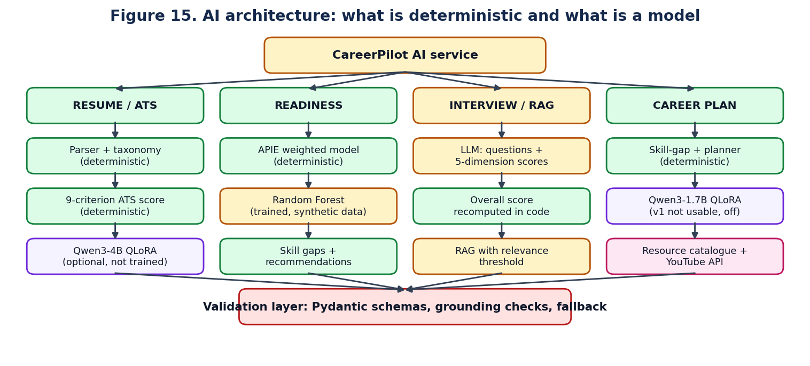
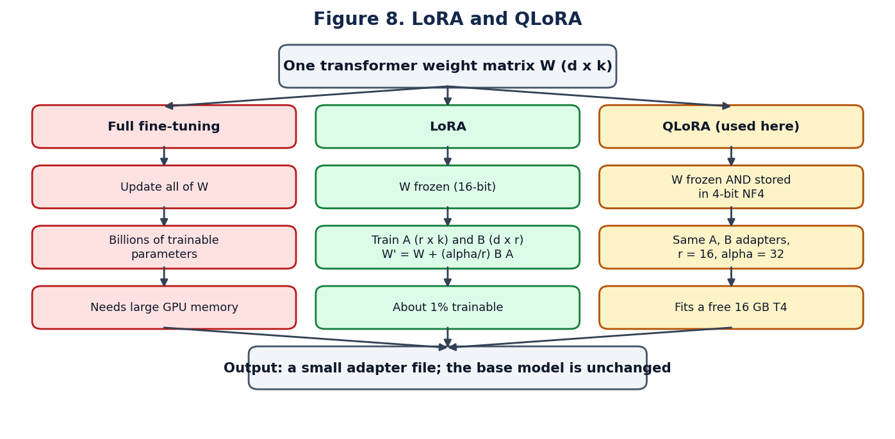
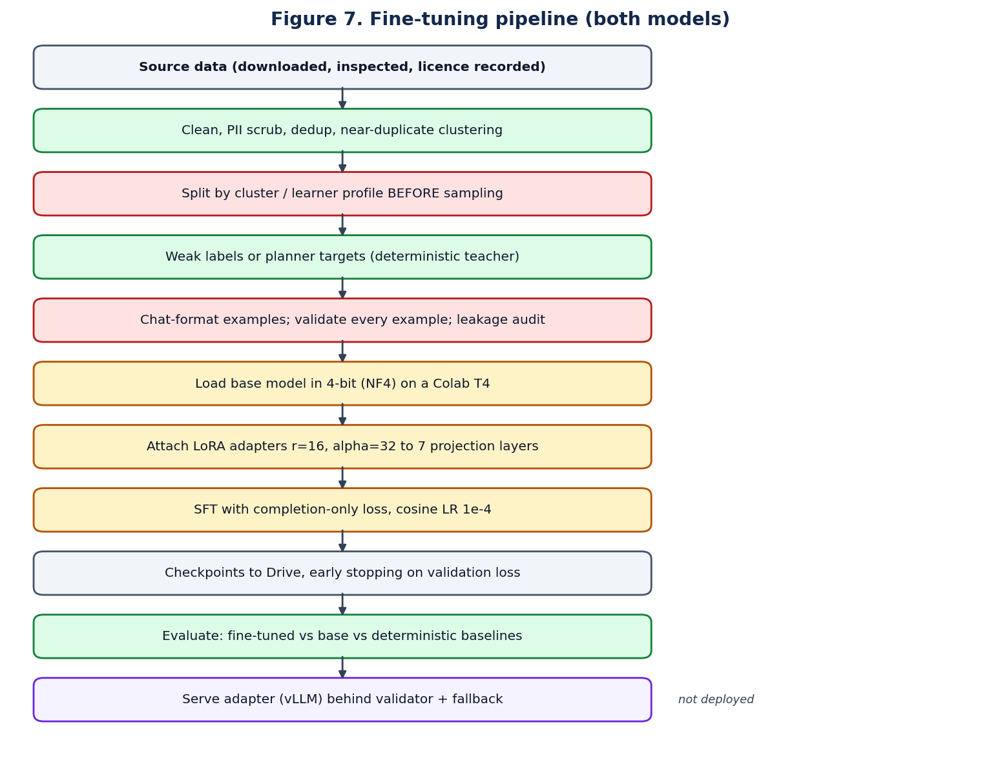

# AI architecture

## The design rule

Every AI feature separates seven things. Being able to name them is the strongest answer you can give about the AI design.

| Part | In CareerPilot |
|---|---|
| MODEL | An LLM provider (or the mock), a Random Forest, optional Qwen3 adapters |
| DATA | Resumes, job descriptions, curated role knowledge, synthetic learner profiles |
| TRAINING | Offline, in Colab notebooks; never inside the application |
| INFERENCE | One call through the provider interface, with a timeout |
| RETRIEVAL | The RAG vector store and the resource catalogue |
| VERIFICATION | Pydantic schemas, grounding checks, resource-ID resolution, URL checks |
| DETERMINISTIC LOGIC | ATS score, APIE, job match, judge verdicts, the planner, all final arithmetic |



## Agents and orchestration

An agent is a class with one responsibility, a typed input schema, a typed output schema and a `handle()` method. `BaseAgent.run()` wraps every agent with the same four steps: validate input, run, validate output, record latency and provider.

| Agent | Responsibility | Uses an LLM |
|---|---|---|
| Resume Intelligence | Parse a resume, compute the ATS score, match JD keywords | Only to phrase advice, and only if the fine-tuned model is enabled |
| Job Matching | Score a student against a job | No |
| Coding Assessment | Static review of submitted code (advisory) | Yes |
| Technical / HR / Behavioural Interview | Generate the next question | Yes |
| Interview Evaluation | Score an answer on five dimensions | Yes; overall recomputed in code |
| Placement Readiness | Run APIE | No |
| Alumni Mentorship, Feedback Ingest | Match mentors; convert human feedback to signals | No |
| Analytics | Cohort statistics | No |

There are **11 registered agents** and two fixed workflows: `RESUME_TO_MATCH` and `INTERVIEW_TURN`.

**Agents never call each other.** Composition happens only in the orchestrator, so the call graph is acyclic and every multi-step flow is a named, auditable operation.

> **If asked "is this really agentic AI?"** It is a multi-agent architecture with orchestrated, deterministic workflows. The agents are specialised and adaptive, but they do not plan autonomously or call tools in a loop. That was chosen for auditability in an assessment system.

## The LLM layer

One interface (`complete_json`) with four providers selected by `AI_PROVIDER`: `openai` (any OpenAI-compatible endpoint), `azure`, `ollama` and `mock`. This is the Strategy pattern.

Three controls apply wherever a model is called:

1. **Structured output.** Prompts demand JSON matching a schema; the response is parsed and validated.
2. **Low temperature** (0.15–0.2 for evaluation) so the same answer gets a consistent score.
3. **Score recomputation.** The model returns dimension scores; the overall is recomputed from fixed weights.

**The mock provider is not a language model.** It assembles schema-valid responses with rules over the real input so the platform runs offline. Every mock response is tagged `provider: "mock"`.

# Algorithms used in CareerPilot

Only algorithms present in the source are listed. TF-IDF and a learned neural ranker are **not** used anywhere; do not claim them.

## Summary table

| # | Algorithm | Used for | Complexity |
|---|---|---|---|
| 1 | Dictionary matching with custom word boundaries | Skill extraction | O(n · t) |
| 2 | Pattern-based section detection | Resume structure | O(lines) |
| 3 | Named-entity recognition (spaCy) | Candidate name | Linear in text |
| 4 | Capped weighted multi-criteria scoring | ATS score, APIE, job match, mentor match | O(k) criteria |
| 5 | Feature hashing with sub-linear term frequency | Default text embedding | O(n) |
| 6 | Cosine similarity | Job match, RAG | O(d) |
| 7 | Exact vector search | RAG retrieval | O(N · d) |
| 8 | Overlapping boundary-aware chunking | RAG ingestion | O(n) |
| 9 | Relevance-threshold gating | Hallucination control in RAG | O(k) |
| 10 | Harmonic recency weighting | APIE evidence | O(e) |
| 11 | Random Forest (and Gradient Boosting) | Readiness band second opinion | Train O(trees · n log n) |
| 12 | Threshold controller | Interview difficulty | O(1) |
| 13 | Topological ordering of a prerequisite graph | Career plan phases | O(V + E) |
| 14 | Additive priority scoring | Skill-gap priority | O(g) |
| 15 | Feasibility-constrained scheduling with deferral | Study plan | O(g log g) |
| 16 | Deterministic resource ranking | Resource recommendation | O(r log r) |
| 17 | Item-based collaborative filtering | Skill recommender (not live) | O(s · V) per query |
| 18 | MinHash + LSH near-duplicate clustering | ATS dataset splitting | Near-linear |
| 19 | Code generation from a typed signature | DSA harness and starter code | O(parameters) |
| 20 | Structural JSON comparison with tolerance | Judge comparator | O(answer size) |
| 21 | Verdict classification | Judge | O(1) per test |
| 22 | bcrypt, HMAC-signed JWT, token rotation | Security | Fixed cost |
| 23 | QLoRA | Fine-tuning both models | See training chapter |

## Skill extraction — dictionary matching

- **Input:** resume or JD text. **Output:** canonical skill names.
- **How it works:** each of 107 skills and 181 aliases is compiled to a regular expression with the boundary `(?<![a-zA-Z0-9+#])term(?![a-zA-Z0-9+#])`. Separators inside a term are flexible, so `node.js`, `node js` and `nodejs` all match. Aliases map to one canonical name.
- **Why selected:** deterministic, explainable, needs no training data, cannot invent a skill.
- **Alternative:** a neural NER model for skills. **Why not:** needs labelled data, can hallucinate, and is harder to explain to a student.
- **Limitation:** finds only skills in the taxonomy.

## Feature hashing embedding

- **Input:** text. **Output:** a 384-dimensional unit vector.
- **Steps:** tokenise and count; weight each token `(1 + ln(count)) × sign`; add it to bucket `MD5(token) mod 384`; for tokens longer than five characters add character trigrams at weight 0.25; L2-normalise.
- **Why selected:** needs no download, no network and no GPU.
- **Alternative:** `sentence-transformers` (all-MiniLM-L6-v2) or OpenAI embeddings, selectable with `EMBEDDING_PROVIDER`. **Why not default:** they need a model download or an API key.
- **Be precise:** this is a *lexical* embedding. It captures shared words, not meaning.

## Cosine similarity and vector search

`cos(a, b) = (a · b) / (‖a‖ ‖b‖)`. All vectors are L2-normalised, so cosine similarity equals the dot product and a search is one matrix–vector multiplication. The NumPy store and FAISS `IndexFlatIP` are both **exact** search. Approximate indexes (HNSW, IVF) are not used because the corpus is small.

## Harmonic recency weighting

```
value = Σ (score_i × 1/(i+1)) / Σ 1/(i+1)        i = 0 for the newest result
```

Improvement shows quickly, but one bad day does not erase a track record. **Alternative:** a plain mean (ignores recency) or latest-only (too noisy).

## Random Forest

- **Task:** classify a student into one of four readiness bands from 14 features (7 component scores, project count, certification count, internship months, alumni feedback score, open skill gaps, assessments taken, interviews taken).
- **Settings:** 300 trees, max depth 12, minimum 4 samples per leaf, balanced class weights, `StandardScaler → classifier`, 80/20 stratified split.
- **How it works:** each tree trains on a bootstrap sample and considers a random subset of features at each split; the forest votes. Averaging decorrelated trees reduces variance.
- **Why selected:** works well on small tabular data, needs little tuning, gives feature importances.
- **Alternative:** Gradient Boosting (available in the code), logistic regression, a neural network. **Why not a neural network:** far too little data.

## Prerequisite graph and topological order

The skill graph has 122 nodes, 123 edges, 24 roots and maximum depth 6, verified acyclic at build time. A topological order guarantees every skill appears after its prerequisites. The planner groups gap skills into phases following that order. **Alternative:** ordering by priority alone, which could schedule React before JavaScript.

## Skill-gap priority score

```
priority = importance × 10            role importance 1–5 (a prerequisite inherits 80% of the skill that needs it)
         + 8   if a core requirement
         + 6   per gap skill it unblocks (capped at 24)
         + 12  if the ATS analysis listed it as missing
         + 4   per level to climb
HIGH ≥ 62   MEDIUM ≥ 40   otherwise LOW
```

The weights are a stated design choice, not learned values. Each gap is returned with the reasons that produced its score.

## Item-based collaborative filtering (skill recommender)

```
similarity(i, j) = cooccurrence(i, j) / ( sqrt(count_i × count_j) + shrinkage )      shrinkage = 5
score(candidate) = Σ similarity(candidate, s)  over the skills s the student has
```

Trained on 844 skill "baskets" extracted from real job descriptions and resumes. It beat a popularity baseline and a PPMI + SVD embedding model. **It is not wired into a live feature**: the agent that used it was removed. Its co-occurrence data is reused read-only as job-demand evidence when the career knowledge base is built.

## Judge comparator and verdict classification

Both the expected and the returned value are parsed as JSON and compared structurally, so spacing, trailing newlines or `5` versus `5.0` cannot change a verdict. Floating-point answers use a relative tolerance of 1e-6. A problem may declare `unordered` or `unorderedNested` comparison (for example Two Sum, Subsets). The verdict rule is a fixed decision list (see the DSA module).

# How the AI models are trained

## Beginner: what is an LLM?

A large language model is a neural network trained to predict the next token (a word piece) given the text so far. It has seen a very large amount of text, so it can continue a prompt in a way that reads sensibly. It does not look facts up; it generates what is statistically likely.

## Intermediate: what is fine-tuning?

Fine-tuning continues training a pre-trained model on a smaller, task-specific dataset so it behaves the way a task needs — here, producing a strict JSON structure for an ATS assessment or a career plan.

## Advanced: the terms you must be able to define

| Term | Definition | Simple example |
|---|---|---|
| SFT (supervised fine-tuning) | Training on input → target pairs | Resume in, the expected JSON assessment out |
| PEFT | Parameter-efficient fine-tuning: train a small number of extra parameters and freeze the rest | Adding sticky notes to a textbook instead of rewriting it |
| LoRA | Low-Rank Adaptation: for a weight matrix W, learn two small matrices A and B and use `W + (α/r)·B·A` | A 4096×4096 matrix has ~16.8M numbers; with rank 16, A and B together have ~131K |
| QLoRA | LoRA on a base model stored in 4-bit precision | The same textbook, printed smaller, with the same sticky notes |
| Quantization | Storing weights with fewer bits | 16-bit to 4-bit cuts memory by about four times |
| 4-bit NF4 | A 4-bit format designed for normally distributed weights | Used by bitsandbytes |
| Rank (r) | Width of the adapter matrices; higher means more capacity | r = 16 here |
| Alpha (α) | Scaling of the adapter's contribution | α = 32 here, so the scale is α/r = 2 |
| Batch size | Examples processed per forward pass | 1 or 2 on a T4 |
| Gradient accumulation | Summing gradients over several small batches before updating | 1 × 16 behaves like a batch of 16 |
| Gradient checkpointing | Recomputing activations during the backward pass to save memory | Slower, but fits in memory |
| Learning rate | Step size of each update | 1e-4 here |
| Scheduler | How the learning rate changes over time | Cosine decay after a short warm-up |
| Optimizer | The update rule | `paged_adamw_8bit` |
| Epoch | One pass over the training set | 2 planned |
| Validation | Measuring loss on data not trained on | Used for early stopping |
| Checkpoint | A saved copy of the adapter during training | Every 25 or 50 steps to Google Drive |
| Overfitting | Memorising training data instead of learning the task | Training loss falls while validation loss rises |
| Completion-only loss | Loss computed only on the answer tokens | The model learns the JSON, not to reproduce the resume |

## Full fine-tuning, LoRA and QLoRA compared



| | Full fine-tuning | LoRA | QLoRA (used here) |
|---|---|---|---|
| What is trained | Every weight | Small adapter matrices | Small adapter matrices |
| Base model during training | Updated, 16-bit | Frozen, 16-bit | Frozen, **4-bit** |
| Trainable parameters | 100% (billions) | Around 1% | Around 1% (ATS: about 33 million, ~0.8%) |
| GPU memory | Very high | Moderate | Lowest; fits a free 16 GB T4 |
| Output | A full model copy (gigabytes) | An adapter file | An adapter file |
| Risk of forgetting general ability | Higher | Low | Low |
| Cost | Highest | Low | Lowest, slightly slower per step |

**Why QLoRA was selected:** the only GPU available was a free Colab T4 with 16 GB. Full fine-tuning a 4-billion-parameter model does not fit. QLoRA fits, produces a small adapter that can be versioned and swapped, and leaves the base model untouched so the untuned model can be evaluated for comparison with the adapter disabled.

## The two models

| | ATS model | Career model |
|---|---|---|
| Version name | `careerpilot-ats-qwen3-4b-v1` | `career-roadmap-qwen3-1.7b-v1` |
| Base model | Qwen/Qwen3-4B-Instruct-2507 | Qwen/Qwen3-1.7B |
| Approximate size | 4 billion parameters | 1.7 billion parameters |
| Licence of base | Apache-2.0 | Apache-2.0 |
| Method | QLoRA, r 16, α 32, dropout 0.05, all 7 projection layers | Same |
| Trainable parameters | About 33 million (~0.8%) | [NOT VERIFIED FROM SOURCE] — not recorded |
| Quantization | 4-bit (Unsloth bnb-4bit; fallback bitsandbytes NF4) | 4-bit |
| Task | Component scores + evidence as JSON, two modes | A career plan as JSON, 32 task types |
| Training examples | 2,162 | 7,157 available; **591 used in v1** |
| Validation / test | 470 / 485 (+ 476 for human review) | 957 / 1,802 |
| Max sequence length | 3,072 on a T4 | 4,096 |
| Batch × accumulation | 1 × 16 | 2 × 8 (v1); notebook changed to update every 4 for v2 |
| Learning rate, schedule | 1e-4, cosine, 10 warm-up steps, weight decay 0.01 | 1e-4, cosine, weight decay 0.01 |
| Optimizer | `paged_adamw_8bit` | [NOT VERIFIED FROM SOURCE] |
| Epochs | 2 with early stopping (patience 3) | 2 planned; **1 in v1** |
| Checkpoints | Every 25 steps | Every 50 steps, latest 3 kept, auto-resume |
| Loss | Completion only | Answer tokens only |
| Hardware | Colab T4 (planned) | Colab T4 |
| **Training status** | **Not run. No adapter exists in the repository.** | **v1 run: 37 updates, 82 minutes** |
| **Serving status** | Off (`ATS_MODEL_PROVIDER=none`) | Off (`CAREER_MODEL_PROVIDER=none`) |

### Why these base models

- **Open licence.** Both are Apache-2.0, so adapters can be trained and used freely.
- **Size fits the hardware.** A 4B model in 4-bit fits a T4 with sequences of about 3,000 tokens. The career model uses a smaller 1.7B model because its sequences are longer (up to 4,096 tokens) and it only has to organise facts supplied in the prompt.
- **Instruction-tuned.** The ATS base is the non-thinking instruct variant, so it emits JSON without a reasoning block. Qwen3-1.7B is a thinking model; prompts are rendered with thinking disabled and a test confirms the training prompt equals the serving prompt token for token.

No comparison with Llama, Mistral or Gemma was run. Do not claim Qwen is better than them; say it met the licence, size and format requirements.

## ATS fine-tuning pipeline



1. **Sources inspected, not assumed.** Three public datasets were downloaded and examined: 4,817 structured resumes (MIT), 6,374 resume–JD pairs (Apache-2.0) and 93,733 pairs (no licence declared).
2. **A provided score was rejected.** One dataset's numeric `ats_score` turned out to be "class band plus noise": within a fit class it correlated with nothing in the text (ρ ≈ −0.001). Only the three-class fit label was kept.
3. **Cleaning and privacy.** Unicode normalisation, PII scrub (emails, phones, profile links replaced with placeholders), quality filter, exact de-duplication.
4. **Near-duplicate clustering.** MinHash (64 permutations) with LSH (16 bands), verified by exact Jaccard ≥ 0.8: 6,063 unique resumes became 5,346 clusters; 659 JDs became 382 clusters.
5. **Split before sampling, by cluster.** Resume clusters are assigned to train, validation, test or human review; JD clusters to train or held-out. A pair is usable only when both agree. The leakage audit reports 0 / 0 / 0 and the build refuses to write otherwise.
6. **Weak labels.** Every target is a documented deterministic function built on the existing ATS engine. **No label is produced by an LLM, and none is a human score.**
7. **Truncate before labelling**, so the model is never trained to cite a skill it cannot see.
8. **Training** in the Colab notebook with the settings in the table above.
9. **Evaluation** on three separate axes: teacher fidelity, external validity against fit labels on unseen JDs, and human agreement (not available until the review sheet is filled).
10. **Serving safety.** JSON extraction, strict schema, grounding guard, one corrective retry, then the deterministic engine.

**The model predicts component scores and evidence only. The final ATS score is always computed in Python from fixed weights; a score the model emits is discarded.**

## Career model fine-tuning pipeline

1. **Knowledge base.** 122 skills, 214 aliases, 123 prerequisite links, 20 roles. O*NET 31.0 and ESCO v1.2.1 corroborate which skills belong to a role; they contain no prerequisites, study hours or projects, so those layers are hand-written and are editorial judgement.
2. **Examples.** A synthetic learner profile is passed through the deterministic planner; the plan becomes the target. 10,000 generated, 9,916 kept (84 exceeded 4,096 tokens).
3. **Split by learner profile.** Train 7,157, validation 957, test 1,802. Two roles — Site Reliability Engineer and Product Analyst — never appear in training, to test generalisation to an unseen role.
4. **Facts in the prompt.** Requirements, gaps with hours and priorities, prerequisite links and candidate resource IDs are supplied. The model explains and organises; it does not need to recall a requirement or a URL.
5. **Training run v1.** 591 examples, 1 epoch, 37 learning updates, 82 minutes on a T4, final validation loss 0.273.
6. **Result.** Not usable — see the evaluation chapter.

> **What this training teaches, honestly.** The targets come from a rule-based planner, so the model learns to reproduce that planner's reasoning in fluent form. It can be measured for validity and faithfulness to the supplied facts. It cannot be shown to give *better* career advice than the planner it learned from.

## Inference and fallback

| Situation | What happens |
|---|---|
| Model provider is `none` (current setting) | The deterministic engine or planner answers |
| Model returns valid, grounded JSON | The answer is used; scores are still recomputed in code |
| JSON invalid or fails the schema | One corrective retry showing the model its error |
| Still invalid, timeout, crash or out of memory | The deterministic result is returned, marked `degraded` with the reason |
| Model names a skill not in the resume as matched | Moved to missing and counted |
| Model names a resource ID not in the catalogue | Dropped and counted |

# Evaluation framework

## Choosing the right metric

Accuracy is only meaningful for classification. Three kinds of quality must be kept apart.

| Kind | Question | Examples here |
|---|---|---|
| MODEL QUALITY | Is the model's output correct? | F1 for the classifier; JSON validity and hallucination rate for an LLM |
| SYSTEM QUALITY | Does the pipeline behave correctly? | Tests passing, verdict correctness, fallback behaviour |
| USER EXPERIENCE | Is it useful to a student? | Human ratings — none collected yet |

## Formulas

```
Accuracy  = (TP + TN) / (TP + TN + FP + FN)        share of all predictions that are correct
Precision = TP / (TP + FP)                          of what was predicted positive, how much was right
Recall    = TP / (TP + FN)                          of what was truly positive, how much was found
F1        = 2 × Precision × Recall / (Precision + Recall)
MAE       = mean |predicted − target|               average size of a score error
Spearman ρ                                          agreement of rankings, from −1 to +1
MRR       = mean (1 / rank of the correct item)
Recall@K  = share of cases where the correct item is in the top K
```

| Metric | Use it when | Do not use it when |
|---|---|---|
| Accuracy | Classes are balanced | Classes are imbalanced — a model predicting the majority looks good |
| Precision | False positives are costly (recommending a skill that is not needed) | You need to know what was missed |
| Recall | False negatives are costly (missing a real skill) | You need to know how much noise was added |
| F1 | You need one number balancing both | Costs of the two errors differ greatly |
| MAE, Spearman | The output is a score or a ranking | The output is a category |
| JSON validity, hallucination rate | The output is generated structured text | — |

## What should be measured for each module

| Module | Metrics | Available now? |
|---|---|---|
| ATS rule-based engine | MAE and rank correlation against weak labels; Spearman against fit labels | [MEASURED] — see the metrics report |
| ATS fine-tuned model | JSON validity, skill precision/recall/F1, hallucination rate, MAE, Spearman vs fit label on unseen JDs | [NOT YET MEASURED] |
| ATS human agreement | Correlation with placement-officer scores | [NOT YET MEASURED] — the review sheet is empty |
| Readiness classifier | Accuracy, macro precision/recall/F1, confusion matrix, cross-validation | [MEASURED] on synthetic data |
| Skill recommender | MRR, Recall@5, Recall@10 with a confidence interval | [MEASURED] |
| RAG | Relevance score separation for on-topic and off-topic questions | [MEASURED] informally for threshold calibration |
| Career model | 13 measures including JSON validity, schema compliance, skill-gap F1, feasibility, resource hallucination | [MEASURED] for v1 on 60 examples |
| Career plan quality | Expert rating on seven criteria | [NOT YET MEASURED] — sheet generated, cells empty |
| DSA judge | Reference solutions accepted; verdict cases | [MEASURED] with local compilers |
| DSA latency, throughput, memory | Per-submission time, concurrent capacity | [NOT YET MEASURED] |
| API latency, page load | Benchmarks | [NOT YET MEASURED] |

> **Rule for the viva.** If a number is not in the metrics report that follows, say "that has not been measured yet" and then say how you would measure it. Never estimate a number aloud.
